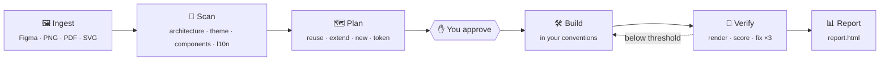

<div align="center">


# Sauces

**Design in. Production mobile UI out. In *your* project's style.**

*We make the sauce; you make the sandwich.*

[](https://code.claude.com/docs/en/plugins)
[](.claude-plugin/plugin.json)
[](#-status)
[](LICENSE)

[](#-supported-platforms)
[](#-supported-platforms)
[](#-supported-platforms)
[](#-supported-platforms)
[](#-supported-platforms)

[Quick start](#-quick-start) · [How it works](#-how-it-works) · [Commands](#-commands) · [Platforms](#-supported-platforms) · [FAQ](#-faq)

</div>

---

Sauces is a [Claude Code](https://code.claude.com) plugin. Hand it a Figma link, screenshots, a PDF of the flow or loose SVG icons. It reads your mobile project first (architecture, theme, components, localization) and then builds the design as **reusable components that look like your team wrote them**. It renders every screen state, scores it against the design, fixes what's off, and finishes with a report you can share.

```text
/sauces:cook ./designs/login.png ./designs/login-error.png
```

```text
▸ ingest…      ✓ ingest (1 screen, 2 states, 1 icon)
▸ scan…        ✓ scan (Flutter · BLoC · Material 3 · en, ar)
▸ plan…        ✓ plan (3 reuse · 1 extend · 2 new · 4 tokens) → waiting for your approval
▸ build…       ✓ build (6 files, 9 strings in 2 locales)
▸ verify…      ✓ verify (default 94 · error 92 · rtl 93)
▸ report…      ✓ report → .sauces/report.html
```

<sub>Illustrative output. Real numbers depend on your design and project.</sub>

## ✨ Why Sauces

Most design-to-code tools assume a clean Figma file and a fresh web app. Real mobile teams have an existing codebase, a half-finished design system and a designer who exported PNGs. Sauces is built for that.

| | |
|---|---|
| 🧭 **Follows your architecture** | Detects MVVM, MVI, BLoC, Riverpod, TCA, Hilt, Koin and more, then writes new UI the same way. No new patterns snuck in. |
| ♻️ **Reuse first** | Every design element maps to **reuse / extend / new / token**. Existing components get optional parameters. Nothing is silently overwritten. |
| 🌍 **Localization built in** | Every user-facing string goes to your localization files in every locale. Existing keys are reused, RTL layouts are rendered and checked, and icons become project assets. |
| 🎯 **Visual verification** | Each state is rendered with your project's own test tooling and scored 0–100 against the design, with up to 3 fix rounds. |
| 🔍 **Design audit** | Measured findings on contrast, touch targets, near-duplicate colors and more, each citing its guideline. You decide per finding whether to keep the design or apply the fix. |
| 📊 **A report you can share** | A self-contained `report.html` with the component graph, reuse stats, the audit, localization coverage and best-practice notes. |
| 🖼️ **Any design source** | Figma links, PNG/JPG screenshots, PDFs and SVGs, mixed freely. Anything unreadable is reported, never skipped silently. |
| 🔒 **Local and opt-in** | All state lives in `.sauces/` in your project. The plugin bundles no MCP server, and Figma is optional. |

## 🚀 Quick start

**1. Install** from inside Claude Code:

```text
/plugin marketplace add siifii/sauces
/plugin install sauces@sauces
```

**2. (Optional) Connect Figma.** Only needed for Figma links. Sauces never adds an MCP server for you:

```bash
claude mcp add --transport http figma https://mcp.figma.com/mcp
```

or connect the Figma connector on claude.ai. Screenshots, PDFs and SVGs work without it.

**3. Cook.** From your app's folder:

```text
/sauces:cook https://figma.com/design/... ./designs/*.png ./flow.pdf
```

Sauces stops once, so you can approve the plan before any code is written. Run the same command again and it resumes where it stopped. With nothing changed, it does nothing.

## 🧪 How it works



### Three modes, picked automatically

| Your folder | Mode | What happens |
|---|---|---|
| 📱 A supported app (at the root or in a child folder) | **Follow** | New UI follows your architecture, state management, theme and folders. Best-practice gaps become optional recommendations (default: keep as is). |
| 📂 Empty (only README, docs, licenses, dotfiles or designs) | **Create** | Offers to scaffold a project with the platform's official tooling, then builds into it. |
| 🤔 Several projects, or one Sauces can't classify | **Ask** | Asks which project to target. It never guesses. |

## 🧰 Commands

| Command | What it does |
|---|---|
| `/sauces:cook <sources…>` | 🍳 The full pipeline: ingest → scan → plan → build → verify → report |
| `/sauces:ingest <sources…>` | 🖼️ Normalize design sources into `.sauces/manifest.json` |
| `/sauces:scan-project` | 🔎 Detect platform, architecture, tokens and components → `.sauces/project-profile.json` |
| `/sauces:scaffold [flutter\|android\|ios\|kmp\|react-native]` | 🏗️ Create a new project in an empty folder |
| `/sauces:plan` | 🗺️ Map design to code (reuse / extend / new / token). Stops for your approval |
| `/sauces:build` | 🛠️ Implement the approved plan in your project's conventions |
| `/sauces:verify` | 🎯 Render every state, score it against the design, fix loop (max 3) |
| `/sauces:report` | 📊 Write a self-contained `.sauces/report.html` |

Each stage also runs on its own, so you can re-plan or re-verify without starting over.

## 📱 Supported platforms

| Platform | UI toolkit | Architectures detected | Visual verification | Scaffold |
|---|---|---|---|---|
|  **Flutter** | Widgets | BLoC/Cubit, Riverpod, Provider; feature-first folders | Flutter widget rendering | `flutter` |
|  **Android** | Jetpack Compose | MVVM/MVI, Hilt/Koin, Material 3 | Screenshot runner or instrumentation | `android` |
|  **iOS** | SwiftUI | MVVM/TCA, SPM modules | Snapshot runner or Xcode UI tests | `ios` |
|  **Compose Multiplatform** | Compose in `commonMain` | Shared vs platform UI, expect/actual | Capture from a mobile host | `kmp` |
|  **React Native** | Expo or bare | Expo Router / React Navigation; hooks, Zustand, Redux Toolkit | Maestro, Detox or device capture | `react-native` |

Android XML Views and UIKit are detected and reported as unsupported targets. For React Native, `/sauces:scaffold react-native` uses Expo; add `--bare` for the Community CLI. Both create the app in `react-native-app/`.

## ⚙️ Configuration

Everything Sauces writes stays in `.sauces/` in your project. Put settings in `.sauces/config.json`:

```json
{ "fidelity_threshold": 95 }
```

| Key | Default | Meaning |
|---|---|---|
| `fidelity_threshold` | `90` | Score (0–100) a state needs before verify stops fixing it |

Consider adding `.sauces/verify/` (render output) to your `.gitignore`.

## 📋 Requirements

- **Claude Code** with plugin support
- **Python 3** with Pillow and numpy: `python3 -m pip install pillow numpy`

<details>
<summary><b>Per platform</b></summary>

| For | You need |
|---|---|
| Flutter | Flutter SDK |
| Android Compose | Android SDK, a compatible JDK, the project's Gradle wrapper |
| SwiftUI | Xcode on macOS with an installed iOS simulator |
| Compose Multiplatform | The Android and iOS toolchains for each host you build or render |
| React Native | Node.js and the app's package manager, plus the native toolchains for native builds |
| PDF inputs | `pdftoppm` (poppler): `brew install poppler` / `apt install poppler-utils` |
| Figma links | A Figma MCP server you connect yourself (see [Quick start](#-quick-start)) |

When rendering isn't available, verify falls back to a manual checklist instead of a score.

</details>

## 🔒 Privacy

Sauces runs inside your Claude Code session. It bundles no MCP server and sends none of your code or designs anywhere itself. Figma data flows only through a Figma MCP server **you** chose to connect. Scaffolding a new project uses the platform's official tooling (for example `flutter create` or `create-expo-app`), which may download templates and packages. All working files stay in `.sauces/` in your project.

## 🚧 Status

**Alpha (v0.1).** Scan, scaffold, build and verify work for all five targets above, and the Flutter path is the most exercised. Live end-to-end runs on the native targets still need validation. Expect rough edges, and please [open an issue](https://github.com/siifii/sauces/issues) when you hit one.

## ❓ FAQ

<details>
<summary><b>Will it overwrite my components?</b></summary>

No. Sauces reuses, extends (with optional parameters) or wraps existing components, and asks when it can't. The plan shows every decision before any code is written.
</details>

<details>
<summary><b>Do I need Figma?</b></summary>

No. Screenshots, PDFs and SVGs work on their own. Figma links need a Figma MCP server you connect yourself. Without one, they're listed as unreadable in the summary and report.
</details>

<details>
<summary><b>What if my project doesn't follow best practices?</b></summary>

Sauces follows what's there. Gaps become optional recommendations in the plan and report, defaulting to "keep as is".
</details>

<details>
<summary><b>Can I run just one stage?</b></summary>

Yes. Every stage is its own command, and `cook` resumes from the last completed stage.
</details>

## 🧑‍💻 Development

```text
.claude-plugin/   plugin.json, marketplace.json
assets/           plugin icon
skills/           cook, ingest, scan-project, scaffold, plan, build, verify, report
agents/           design-analyst, component-builder, fidelity-checker
scripts/          Python 3 helpers (Pillow + numpy), including eval.py
examples/         sample designs and target projects
docs/superpowers/ spec and build plans
```

```bash
python3 -m venv .venv && .venv/bin/pip install pillow numpy pytest
.venv/bin/python -m pytest -q            # default tests
.venv/bin/python -m pytest -m skill -v   # headless claude runs (slow, uses tokens)
claude plugin validate .
claude --plugin-dir .                    # try your local copy
```

<details>
<summary><b>Evals and mobile parity checks</b></summary>

Evals score full `cook` runs on the fixtures in `examples/targets/`:

```bash
.venv/bin/python scripts/eval.py --run --fixtures flutter-bloc,empty --out eval.md
```

`--run` copies each fixture to a temp folder, writes `.sauces/eval-approve` there (the plan is approved automatically, and cook deletes the file when it finishes) and calls `claude` once per fixture. It costs tokens, needs network, and results vary between runs. No passing baseline has been recorded yet. Without `--run`, `eval.py --results <dir>` scores existing runs. A row passes when the project builds, every state rendered, the generated code passes lint, and the default state scores ≥ 90. With `--run`, cook must also exit successfully.

The default tests include a Flutter render-template check when Flutter and the fixture's dependencies are available. Run `flutter pub get` in `examples/targets/flutter-bloc` to enable it.

The SDK-backed suite builds the fixtures and fresh starters for Android Compose, SwiftUI and Compose Multiplatform, type-checks and bundles Expo for both platforms, and checks that the bare React Native template generates both native hosts. Set `SAUCES_ANDROID_SERIAL` or `SAUCES_IOS_SIMULATOR` to capture on an already booted test device reserved for the run.

```bash
.venv/bin/pytest -m mobile
```

The live evaluator starts a fresh Claude Code pipeline. Run it once per existing fixture, then once per platform with `--fixtures empty --create-platform <platform-id>`, using a fresh results directory each time. Add `--bare` to the React Native create run for the Community CLI template. `--require-captures` requires passing, deterministic captures for every state, plus clean RTL captures when the profile declares RTL support.

```bash
.venv/bin/python scripts/eval.py --run --fixtures android-compose \
  --results /tmp/sauces-android-follow --builds-cmd './gradlew assembleDebug' --require-captures
.venv/bin/python scripts/eval.py --run --fixtures empty --create-platform react-native \
  --results /tmp/sauces-expo-create --builds-cmd 'npx expo export --platform android --platform ios' \
  --require-captures
```

Fixture results show the sample code builds or renders. Live results show whether Sauces can scaffold or modify it and reproduce the design. A live run needs Claude usage credits, platform SDKs and a working device or screenshot runner.

</details>

## 🤝 Contributing

Issues and pull requests are welcome. Read [`docs/superpowers/spec.md`](docs/superpowers/spec.md) and [`docs/superpowers/plan.md`](docs/superpowers/plan.md) first, keep skills as imperative instructions for Claude, and run the tests and `claude plugin validate .` before opening a PR.

## 📄 License

[MIT](LICENSE) © 2026 Kareem Alsaifi

<div align="center"><sub>Made with 🥫 for mobile teams who are tired of pixel-pushing.</sub></div>
